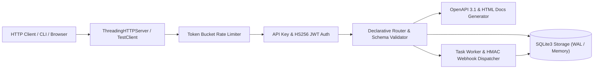

# PyApiForge (`py-apiforge`)

**外部依存ゼロ（Python 標準ライブラリのみ）で動作する宣言的 REST API マイクロフレームワーク、OpenAPI 3.1 自動生成、HS256 JWT / HMAC-SHA256 認証、Token Bucket レートリミッタ、および SQLite 非同期タスク＆署名付き Webhook 配信エンジン**

---

## 主な機能

1. **宣言的ルーティング & スキーマバリデーション (`apiforge.router`, `apiforge.schema`)**
   - `@app.get`, `@app.post`, `@app.delete` デコレータによる直感的なエンドポイント定義とパスパラメータ（`/api/v1/tasks/{task_id}`）の自動抽出
   - Python 標準の `dataclass` と型ヒント（`str`, `int`, `float`, `bool`, `list[T]`, `T | None`, `Literal`）からリクエスト JSON を自動検証
   - エラー時は **RFC 7807 Problem Details (`application/problem+json`)** 形式で構造化されたエラーレスポンスを返却

2. **OpenAPI 3.1.0 自動生成 & インタラクティブ API ドキュメント (`apiforge.openapi`)**
   - 登録された全ルート・型ヒント・Docstring から **OpenAPI 3.1.0 JSON (`/openapi.json`)** を動的生成
   - 外部 CDN や JS ライブラリに依存しない単一 HTML の API コンソール画面（`GET /docs`）を内蔵

3. **多層セキュリティ & レート制限 (`apiforge.security`, `apiforge.ratelimit`)**
   - **HS256 JWT トークン認証**: 標準ライブラリ `hmac` + `hashlib.sha256` による署名・有効期限 (`exp`) 検証
   - **API Key 認証**: `hmac.compare_digest` によるタイミング攻撃耐性のあるキー検証
   - **Webhook HMAC 署名**: 配信ペイロードに対する `t=<timestamp>,v1=<hmac_sha256>` 署名生成とリプレイ攻撃防止ウィンドウ検証
   - **Token Bucket レートリミッタ**: クライアント単位のトークンバケット制限と `X-RateLimit-Limit`, `X-RateLimit-Remaining`, `X-RateLimit-Reset`, `Retry-After` ヘッダ自動付与

4. **SQLite 永続化・タスクワーカー・監査ログ・Prometheus メトリクス (`apiforge.storage`, `apiforge.worker`)**
   - `sqlite3`（WAL モード対応 / `:memory:` 対応）によるタスク・Webhook・配信履歴・HTTP 監査ログの永続化
   - 優先度付きタスク実行（`transform_payload`, `compute_stats`, `hash_content` 等のアクション）とリトライ管理
   - `GET /metrics` による JSON テレメトリおよび Prometheus テキスト形式（`?format=prometheus`）エクスポータ

---

## システムアーキテクチャ



---

## ディレクトリ構成

```text
py-apiforge/
├── .github/workflows/ci.yml        # GitHub Actions CI (Python 3.11〜3.13 自動テスト & OpenAPI 検証)
├── pyproject.toml                  # パッケージ定義 (外部依存ゼロ、CLI エントリポイント `apiforge`)
├── README.md                       # ドキュメント
├── LICENSE                         # MIT License
├── src/
│   └── apiforge/
│       ├── __init__.py             # パブリック API エクスポート
│       ├── __main__.py             # `python -m apiforge` エントリポイント
│       ├── schema.py               # Dataclass バリデータ & OpenAPI 3.1 JSON Schema 変換
│       ├── security.py             # HS256 JWT 発行/検証・API Key 認証・HMAC-SHA256 Webhook 署名
│       ├── ratelimit.py            # Token Bucket レートリミッタ (`X-RateLimit-*` ヘッダ付与)
│       ├── router.py               # デコレータ型ルーター & RFC 7807 Problem Details ハンドラ
│       ├── openapi.py              # OpenAPI 3.1.0 スキーマ & API ドキュメント HTML 生成
│       ├── storage.py              # SQLite3 リポジトリ層 (Tasks / Webhooks / Deliveries / Audit Logs)
│       ├── worker.py               # タスク処理エンジン & 署名付き Webhook ディスパッチャ
│       ├── app.py                  # REST API アプリケーション本体 & エンドポイント定義
│       ├── server.py               # ThreadingHTTPServer アダプタ & インメモリ TestClient
│       └── cli.py                  # サブコマンド対応 CLI (`serve`, `routes`, `openapi`, `token`)
└── tests/
    ├── test_schema_and_security.py # バリデーション・JWT・HMAC・レート制限の単体テスト
    ├── test_router_and_openapi.py  # ルーティング・OpenAPI 3.1 スキーマ生成テスト
    └── test_api_integration.py     # E2E API 統合テスト (認証・タスク実行・Webhook・HTTP サーバー)
```

---

## クイックスタート

### 1. CLI コマンド一覧

外部パッケージのインストール不要で、Python 3.11 以上があればそのまま実行できます。

```bash
# 登録済み全 API ルート一覧を表示
PYTHONPATH=src python3 -m apiforge routes

# OpenAPI 3.1.0 スキーマ JSON を出力
PYTHONPATH=src python3 -m apiforge openapi --output openapi.json

# 開発・テスト用 HS256 JWT アクセストークンを発行
PYTHONPATH=src python3 -m apiforge token --sub admin --role admin

# REST API サーバーを起動 (デフォルト: http://127.0.0.1:8000, Docs: http://127.0.0.1:8000/docs)
PYTHONPATH=src python3 -m apiforge serve --host 127.0.0.1 --port 8000 --db apiforge.db
```

### 2. 標準搭載 API エンドポイント一覧

| Method | Path | Auth | 概要 |
| :--- | :--- | :--- | :--- |
| `GET` | `/health` | Public | ヘルスチェック・稼働時間・DB 接続状態 |
| `GET` | `/metrics` | Public | リクエスト数・平均レイテンシ・Prometheus 形式メトリクス |
| `GET` | `/openapi.json` | Public | OpenAPI 3.1.0 仕様 JSON |
| `GET` | `/docs` | Public | ブラウザ用インタラクティブ API ドキュメント画面 |
| `POST` | `/api/v1/auth/token` | Required | HS256 JWT アクセストークンの発行 |
| `POST` | `/api/v1/tasks` | Required | 非同期タスクの新規作成（バリデーション・永続化） |
| `GET` | `/api/v1/tasks` | Required | ステータスフィルタ・ページネーション付きタスク一覧取得 |
| `GET` | `/api/v1/tasks/{task_id}` | Required | タスク詳細情報の取得 |
| `POST` | `/api/v1/tasks/{task_id}/process` | Required | タスクの即時実行 & HMAC 署名付き Webhook イベント配信 |
| `DELETE` | `/api/v1/tasks/{task_id}` | Required | タスクの削除 |
| `POST` | `/api/v1/webhooks` | Required | Webhook エンドポイント購読の登録 |
| `GET` | `/api/v1/webhooks` | Required | 登録済み Webhook と署名付き配信履歴の取得 |
| `GET` | `/api/v1/audit-logs` | Required | API リクエスト監査ログの取得 |

---

## テストの実行

```bash
PYTHONPATH=src python3 -m unittest discover -s tests -v
```

## ライセンス

MIT License
